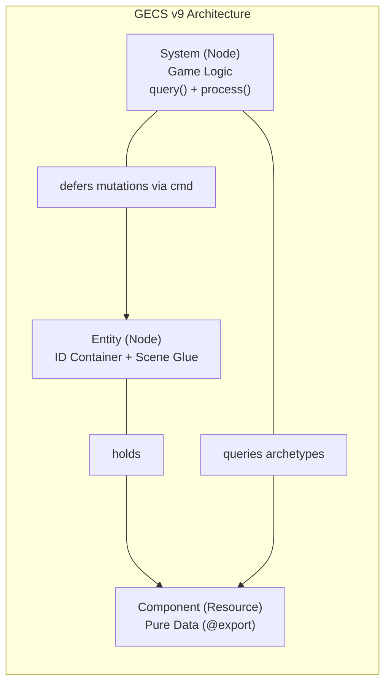

# GECS Core in Godot 4.3+

Build scalable, data-driven games using GECS (Godot Entity Component System v9). Decouple game state into pure data components and process entities at scale with archetype-backed systems. All patterns target Godot 4.3+ and GECS v9 with GDScript 2.0 type safety.

> **Addon:** GECS · version `v9` · Godot 4.3+ · MIT · source: https://github.com/csprance/gecs  
> **Related skills:** **gecs-systems** for scheduling & sub-systems, **gecs-queries** for fluent queries & change detection, **gecs-relationships** for entity/component pairs, **gecs-observers** for reactive events, **gecs-performance** for cache tuning & pooling.

---

## 1. When to Use GECS vs Standard Godot Nodes

| Metric / Requirement | Traditional Godot OOP / Nodes | GECS (Hybrid Archetype ECS) |
|---|---|---|
| **Architecture** | Nodes combine state + behavior | Pure data (`Component`) + Logic (`System`) |
| **Inheritance** | Deep inheritance trees (`Player extends Character extends Entity`) | Flat composition (entities have arbitrary components) |
| **Scale** | Hundreds of active ticking nodes | Thousands to tens of thousands of active entities |
| **Memory layout** | Scattered Node heap allocations | SoA (Structure of Arrays) contiguous column storage |
| **Cache locality** | Low (cache misses across node trees) | High (batch iteration via `iterate()`) |
| **Structural changes** | Immediate `queue_free()` / `add_child()` | Deferred via `cmd: CommandBuffer` (zero corruption) |
| **Best suited for** | UI (`Control`), level scenes, visual trees | Mass gameplay entities, combat, bullets, AI, physics batches |

---

## 2. Install & World Setup

### 1. Installation
1. Copy or submodule `addons/gecs/` into your project's `res://addons/gecs/`.
2. Enable plugin: **Project → Project Settings → Plugins → GECS** (check enabled).
3. Confirm AutoLoad: **Project Settings → AutoLoads** must show `ECS` pointing to `res://addons/gecs/ecs.gd`.

### 2. Recommended Scene Hierarchy

```text
main.tscn
├── Main (Node2D or Node3D)               ← attaches main.gd
└── World (World)                         ← built-in GECS World node
    └── Systems (Node)
        ├── run-first (SystemGroup)       ← VictimInit, StorageLoad
        ├── input     (SystemGroup)       ← PlayerInputSystem
        ├── gameplay  (SystemGroup)       ← MovementSystem, CombatSystem
        ├── physics   (SystemGroup)       ← CollisionResolveSystem
        ├── ui        (SystemGroup)       ← HealthBarSystem
        └── run-last  (SystemGroup)       ← PendingDeleteSystem, ActionsCleanup
```

### 3. Minimal Main Controller (`main.gd`)

```gdscript
extends Node2D

@onready var world: World = $World


func _ready() -> void:
	# 1. Bind active world to ECS singleton
	ECS.world = world

	# 2. Spawn entities through ECS.world.add_entity()
	_spawn_player()


func _process(delta: float) -> void:
	# Ticks all registered systems in order
	ECS.process(delta)
	# Or tick specific groups individually:
	# world.process(delta, "input")
	# world.process(delta, "gameplay")


func _spawn_player() -> void:
	var player := Entity.new()
	player.name = "Player"
	player.position = Vector2(200, 200)

	var sprite := Sprite2D.new()
	sprite.texture = preload("res://icon.svg")
	player.add_child(sprite)

	var vel := C_Velocity.new(Vector2.RIGHT, 150.0)
	
	# CRITICAL: add_entity manages scene-tree placement.
	# Do NOT call add_child(player) before add_entity!
	ECS.world.add_entity(player, [vel])
```

---

## 3. The Three Primitives



### 1. Entity (`extends Entity`)
* An `Entity` is a Godot `Node` that acts as the container for components and the bridge to the SceneTree.
* **Scene Glue Pattern:** Store node references (like `CollisionShape2D`, `NavigationAgent3D`, `AnimationPlayer`) on the entity script as glue code, **not** inside components.
* **Spatial Roots:** Attach entity scripts to `Node2D` or `Node3D` roots to access `global_position` and transforms.
* **Generational IDs (v9):** `entity.id` is an int64 handle (0 before being added to world). For singletons, set `entity.alias = &"player"`.

### 2. Component (`extends Component`)
* A `Component` is a `Resource` containing **pure data only — zero game logic**.
* **Mandatory Rule:** All `_init()` arguments **must have default values**; GECS instantiates components dynamically.
* **Serialization:** Only `@export` variables are saved when serializing.
* **Reactive Setters:** If an observer needs to detect property changes, emit `property_changed`:
  ```gdscript
  @export var hp: int = 100:
      set(val):
          var old := hp
          hp = val
          property_changed.emit(self, &"hp", old, val)
  ```

### 3. System (`extends System`)
* A `System` is a `Node` containing logic for matching entities.
* `query() -> QueryBuilder`: Specifies entity criteria using `q.with_all([C_A])`.
* `process(entities: Array[Entity], components: Array, delta: float)`: Runs each frame for matched archetypes.
* **SoA Batching with `iterate()`:** Call `q.with_all([C_Velocity]).iterate([C_Velocity])` to retrieve aligned column arrays directly from archetype memory (3–5x faster than per-entity `get_component()`).
* **Safe Mutations via `cmd`:** Always queue entity/component additions or removals via `cmd: CommandBuffer` so they flush cleanly after iteration without invalidating the loop array.

---

## 4. Minimal Working Example

### Component (`c_velocity.gd`)
See template at [`examples/c_velocity.gd`](./examples/c_velocity.gd).

```gdscript
class_name C_Velocity
extends Component

@export var direction: Vector2 = Vector2.ZERO
@export var speed: float = 200.0


func _init(dir: Vector2 = Vector2.ZERO, spd: float = 200.0) -> void:
	direction = dir
	speed = spd
```

### System (`s_movement.gd`)
See template at [`examples/s_movement.gd`](./examples/s_movement.gd).

```gdscript
class_name MovementSystem
extends System


func query() -> QueryBuilder:
	# iterate() passes the C_Velocity column array in components[0]
	return q.with_all([C_Velocity]).iterate([C_Velocity])


func process(entities: Array[Entity], components: Array, delta: float) -> void:
	var velocities: Array = components[0]

	for i in entities.size():
		var entity := entities[i]
		var vel := velocities[i] as C_Velocity
		entity.position += vel.direction * vel.speed * delta
```

### Entity with Scene Glue (`e_player.gd`)
See template at [`examples/e_player.gd`](./examples/e_player.gd).

```gdscript
class_name Player
extends Entity

# Scene glue: cache node references directly on entity
@onready var sprite: Sprite2D = $Sprite2D


func define_components() -> Array:
	return [
		C_Velocity.new(Vector2.RIGHT, 180.0)
	]


func on_ready() -> void:
	# Called after components are registered and entity is in the World
	pass
```

---

## 5. Core Rules & Invariants

```text
┌─────────────────────────────────────────────────────────────────────────────┐
│                             GECS GOLDEN RULES                               │
├─────────────────────────────────────────────────────────────────────────────┤
│ 1. NEVER call add_child(entity) before ECS.world.add_entity(entity).        │
│    add_entity manages scene tree placement and archetype allocation.        │
│                                                                             │
│ 2. NEVER mutate world directly during iteration loops.                      │
│    Use cmd.remove_entity(e), cmd.add_component(e, c), etc.                  │
│                                                                             │
│ 3. NEVER put game logic or methods in a Component.                          │
│    Components are pure data (Resource). Logic belongs exclusively in System.│
│                                                                             │
│ 4. ALWAYS provide default arguments in Component _init().                   │
│    GECS instantiates components reflectively without parameters.            │
│                                                                             │
│ 5. NEVER store Node references inside Components.                           │
│    Store node references on the Entity subclass as Scene Glue.              │
│                                                                             │
│ 6. Use entity.alias = &"name" for singletons (v9).                          │
│    Do not use v8 string UUIDs.                                              │
└─────────────────────────────────────────────────────────────────────────────┘
```

For the comprehensive specification of invariants and lifecycle triggers, see [`references/rules-and-invariants.md`](./references/rules-and-invariants.md).

---

## 6. Anti-Patterns & Fixes

### Anti-Pattern 1: Mutating World Directly in System Loop

```gdscript
# ❌ BAD: Mutating entities array while iterating causes skipped elements / crashes
func process(entities: Array[Entity], _components: Array, delta: float) -> void:
	for entity in entities:
		var lifetime := entity.get_component(C_Lifetime) as C_Lifetime
		lifetime.time -= delta
		if lifetime.time <= 0:
			ECS.world.remove_entity(entity) # Direct mutation!


# ✅ GOOD: Queue through CommandBuffer cmd for safe, coalesced execution
func process(entities: Array[Entity], _components: Array, delta: float) -> void:
	for entity in entities:
		var lifetime := entity.get_component(C_Lifetime) as C_Lifetime
		lifetime.time -= delta
		if lifetime.time <= 0:
			cmd.remove_entity(entity) # Deferred and cache-friendly
```

---

### Anti-Pattern 2: Sibling Cast Error (`Entity` to `CharacterBody3D`)

```gdscript
# ❌ BAD: Entity and CharacterBody3D are siblings under Node; direct cast fails
var body := entities[i] as CharacterBody3D # Returns null!


# ✅ GOOD: Upcast to Node first or inspect root type
var node: Node = entities[i]
var body := node as CharacterBody3D
if body:
	body.velocity = Vector3.FORWARD * 10.0
	body.move_and_slide()
```

---

### Anti-Pattern 3: Logic inside Component

```gdscript
# ❌ BAD: Component contains behavior and state logic
class_name C_Health extends Component
@export var current: float = 100.0

func take_damage(amount: float) -> void: # Logic does NOT belong here!
	current -= amount
	if current <= 0:
		print("Died")


# ✅ GOOD: Component holds data only; System executes logic
class_name C_Health extends Component
@export var max_hp: float = 100.0
@export var current_hp: float = 100.0

func _init(p_max: float = 100.0) -> void:
	max_hp = p_max
	current_hp = p_max
```

---

### Anti-Pattern 4: Required Arguments in Component `_init`

```gdscript
# ❌ BAD: Missing default values will crash GECS internal serialization/deserialization
class_name C_Damage extends Component
@export var amount: float

func _init(dmg: float) -> void: # Crash when instantiated dynamically!
	amount = dmg


# ✅ GOOD: Always provide default values
class_name C_Damage extends Component
@export var amount: float = 0.0

func _init(dmg: float = 0.0) -> void:
	amount = dmg
```

