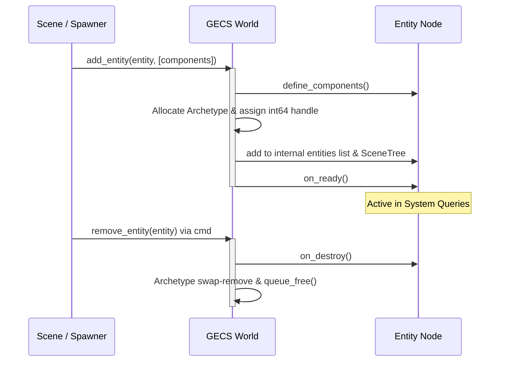

# GECS Core Invariants & Runtime Rules

This reference documents the foundational invariants, lifecycle guarantees, and execution contracts of **GECS v9** in Godot 4.3+.

---

## 1. Entity Lifecycle Contract

An `Entity` in GECS inherits from Godot's `Node`. It serves as the container for components and the bridge between Godot's SceneTree and the ECS archetype storage.



### Lifecycle Methods

| Method | Called When | Purpose |
|---|---|---|
| `define_components() -> Array` | During `world.add_entity()` | Returns initial components defined in script. |
| `on_ready()` | After components loaded and entity registered | Initialize spatial properties, sync transforms (`global_transform`). |
| `on_destroy()` | Immediately before entity is removed from World | Clean up external references, sound cues, or scene tree links. |
| `on_disable()` | When `world.disable_entity(entity)` is called | Pooling / pausing entity without deallocating archetype storage. |
| `on_enable()` | When `world.enable_entity(entity)` is called | Restores entity to active queries. |

### Critical Invariant: Scene Tree Placement
* **RULE:** Never call `add_child(entity)` before calling `ECS.world.add_entity(entity)`.
* `World.add_entity()` automatically places the entity into the scene tree under the designated entities root.
* Adding the node to the scene tree manually prior to `add_entity()` can cause tree-parenting conflicts and duplicate registration warnings.

---

## 2. Component Design Invariants

A `Component` inherits from `Resource`.

### Invariants:
1. **Pure Data Only:** Components must never contain game logic, state machines, or procedural functions. All behavior belongs inside `System` or `Observer`.
2. **Mandatory Default Arguments in `_init()`:**
   * GECS reflectively instantiates components during queries, serialization, and archetype instantiation via `ComponentType.new()`.
   * If any argument in `_init()` lacks a default value, Godot throws a runtime crash: `Too few arguments for _init()`.
3. **Only `@export` Properties Are Serialized:**
   * Unexported member variables (`var _cache`) will be ignored by `ECS.serialize()`.
4. **Reactive Change Notification:**
   * Direct variable assignment (`c.hp -= 10`) does **not** trigger reactive observers (`Observer.Event.CHANGED`).
   * To notify observers, properties must use a setter emitting `property_changed`:
   ```gdscript
   @export var hp: int = 100:
       set(val):
           var old := hp
           hp = val
           property_changed.emit(self, &"hp", old, val)
   ```

---

## 3. System Execution & CommandBuffer Invariants

A `System` inherits from Godot's `Node`.

### Invariants:
1. **Zero-Copy Iteration Safety:**
   * GECS v9 defaults to `safe_iteration = false` for maximum performance (zero array allocations per frame).
   * **INVARIANT:** Never call `ECS.world.remove_entity()`, `entity.add_component()`, or `entity.remove_component()` directly inside a system's `process()` loop.
   * Direct mutation modifies the underlying dense array, causing subsequent entities to be skipped or out-of-bounds indices.
2. **Always Use `cmd: CommandBuffer`:**
   * `cmd.remove_entity(entity)`
   * `cmd.add_component(entity, component)`
   * `cmd.remove_component(entity, component)`
   * Structural operations are queued and executed after the system finishes iterating.
3. **Coalesced Archetype Transitions:**
   * Flushes queued via `cmd` automatically coalesce multiple operations on the same entity.
   * Example: Removing `C_Old` and adding `C_New` executes as a single archetype move instead of two.
4. **Flush Modes:**
   * `FlushMode.PER_SYSTEM` (Default): Flushes commands immediately after the system's `process()` returns.
   * `FlushMode.PER_GROUP`: Flushes after all systems in the current group have finished.
   * `FlushMode.MANUAL`: Flushes only upon calling `world.flush_command_buffers()`.

---

## 4. Generational Entity Handles (v9)

In GECS v9, entity identity was overhauled from v8 string UUIDs to 64-bit generational int handles:

| Feature | GECS v8 (Legacy) | GECS v9 (Current) |
|---|---|---|
| Handle Type | `String` UUID | `int64` generational handle |
| Unregistered Entity ID | Pre-allocated string | `0` (allocated on `add_entity`) |
| Singletons / Named Lookup | `entity.id = "player"` | `entity.alias = &"player"` |
| Stale Handle Checking | Manual lookup | `world.is_alive(handle)` (O(1)) |
| Archetype Retention | Trimmed on empty | Retained across frame churn (`world.compact()` cleans) |

