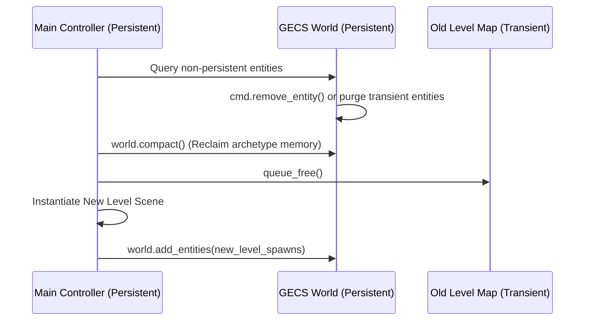

# GECS Level Spawner & Entity Pooling in Godot 4.3+

Manage entity lifecycles across scenes and handle high-volume unit spawning in GECS v9. A common architectural issue in Godot + ECS is tearing down the entire World during level switches, or encountering garbage collection spikes when spawning hundreds of bullets or swarm enemies. This skill establishes the standard patterns for **zero-reboot level transitions**, **in-place entity pooling**, and **Nodeless MultiMesh rendering** for 10,000+ simultaneous units.

> **Addon:** GECS · version `v9` · Godot 4.3+ · MIT  
> **Related skills:** **gecs-core** for setup, **gecs-world-architecture** for world lifecycle, **gecs-performance** for pooling benchmarks.

---

## 1. Zero-Reboot Level Transitions

In Godot, calling `get_tree().change_scene_to_file()` tears down the root scene tree, destroying the ECS World unless it is structured properly. 

### Architectural Rule:
**Keep `World` in the persistent Root/Main controller, and swap only the level environment scenes.**



### Level Transition Implementation:
See [`examples/level_transition_manager.gd`](./examples/level_transition_manager.gd).

```gdscript
class_name LevelTransitionManager
extends Node

@onready var world: World = $World
var current_level_node: Node = null


func switch_level(new_level_scene: PackedScene) -> void:
	# 1. Purge non-persistent entities (or all entities if fresh start)
	_despawn_level_entities()

	# 2. Compact archetype transition edges and free empty columns
	world.compact()

	# 3. Swap the visual map node
	if current_level_node:
		current_level_node.queue_free()
	
	current_level_node = new_level_scene.instantiate()
	add_child(current_level_node)

	# 4. Spawn new level entities into existing world
	_spawn_level_entities(current_level_node)


func _despawn_level_entities() -> void:
	# Keep player / persistent entities, remove level-specific objects
	var transient_entities := world.query.with_none([C_Persistent]).execute()
	for entity in transient_entities:
		world.remove_entity(entity)
```

---

## 2. In-Place Entity Pooling (`enable` / `disable`)

When spawning bullets, projectiles, particle units, or horde enemies, calling `Entity.new()` and `queue_free()` creates severe memory fragmentation and GC pauses in Godot.

### The Pooling Protocol:
* When an entity is "despawned": call `ECS.world.disable_entity(entity)`.
  * **Result:** The entity is excluded from queries (`.enabled()`), retains its components, retains its archetype slot, and stops ticking in systems.
* When an entity is "spawned": call `ECS.world.enable_entity(entity)`.
  * **Result:** Restored to active queries in **0.01 ms** (6× faster than re-allocation).

```gdscript
class_name ProjectilePool
extends RefCounted

var _available: Array[Entity] = []


func spawn_bullet(pos: Vector2, dir: Vector2) -> Entity:
	var bullet: Entity
	if _available.is_empty():
		bullet = Entity.new()
		var vel := C_Velocity.new(dir, 600.0)
		var trans := C_Transform2D.new(pos)
		ECS.world.add_entity(bullet, [vel, trans])
	else:
		bullet = _available.pop_back()
		var vel := bullet.get_component(C_Velocity) as C_Velocity
		var trans := bullet.get_component(C_Transform2D) as C_Transform2D
		vel.direction = dir
		trans.position = pos
		ECS.world.enable_entity(bullet)

	return bullet


func return_bullet(bullet: Entity) -> void:
	ECS.world.disable_entity(bullet)
	_available.append(bullet)
```

---

## 3. Mass Unit Spawning: Nodeless Entities & MultiMesh

When simulating **10,000+ entities** (e.g. vampire-survivors swarms, bullet hell, RTS units), placing 10,000 individual `Node2D` / `Sprite2D` nodes into the Godot SceneTree will tank performance due to scene-graph traversal overhead.

### The Solution:
1. **Nodeless Entities:** Add entities to ECS with `add_to_tree = false`:
   ```gdscript
   ECS.world.add_entity(entity, components, false) # Does NOT attach to SceneTree
   ```
2. **MultiMesh Rendering:** Use a single `MultiMeshInstance2D` or `MultiMeshInstance3D` node to render all entities in **one single draw call**.
3. **Render System:** A system queries `C_Transform2D` and updates the `MultiMesh` buffer in bulk.

See [`examples/multimesh_swarm_system.gd`](./examples/multimesh_swarm_system.gd) and [`references/nodeless-entities-and-multimesh.md`](./references/nodeless-entities-and-multimesh.md).

---

## 4. Anti-Patterns & Fixes

### Anti-Pattern 1: Re-instantiating `World` on Every Level Load

```gdscript
# ❌ BAD: Re-creating World throws away archetype graphs and causes frame hitch
func next_level():
	get_tree().change_scene_to_file("res://level_2.tscn") # World destroyed and rebuilt


# ✅ GOOD: Keep World in persistent main scene, compact memory, and swap map node
func next_level():
	level_manager.switch_level(preload("res://level_2.tscn"))
```

---

### Anti-Pattern 2: `queue_free()` on Rapid-Fire Projectiles

```gdscript
# ❌ BAD: Destroys nodes and forces allocator overhead for 100 bullets/sec
entity.queue_free()


# ✅ GOOD: Disable and push to pool
ECS.world.disable_entity(entity)
bullet_pool.append(entity)
```

