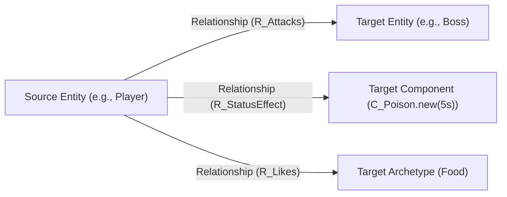

# GECS Relationships in Godot 4.3+

Express links between entities as first-class pairs in GECS v9. A `Relationship` connects a **Source Entity** to a **Target** through a **Relation Component**. Relationships support arbitrary metadata, stacked instances (e.g. poison stacks), wildcard queries, and graduated cleansing.

> **Addon:** GECS · version `v9` · Godot 4.3+ · MIT  
> **Related skills:** **gecs-core** for primitives, **gecs-queries** for relationship queries, **gecs-observers** for `.on_relationship_added()`.

---

## 1. Anatomy of a Relationship

A relationship consists of 3 elements:
1. **Source:** The entity that owns the relationship.
2. **Relation:** A Component instance defining the relationship type (e.g., `R_ChildOf`, `R_Attacking`).
3. **Target:** One of three target types:
   - **Entity:** Linking two entities (e.g., `attacker -> target`).
   - **Component Instance:** Storing link-attached data directly on the relationship (e.g., `unit -> C_Burning.new(10.0)`).
   - **Archetype / Class Type:** Categorical tagging (e.g., `unit -> Food`).



---

## 2. The Three Relationship Types

### 1. Entity → Entity Link
```gdscript
# e_alice is attacking e_bob
e_alice.add_relationship(Relationship.new(R_Attacks.new(), e_bob))
```

### 2. Entity → Component Instance (Link Data)
Attach custom data directly to the connection without modifying the entity's direct archetype:
```gdscript
# Apply 50 fire damage over 5 seconds directly to target
entity.add_relationship(Relationship.new(R_Damaged.new(), C_FireDamage.new(50.0, 5.0)))
```

### 3. Entity → Archetype
Tag relationships with high-level classifications:
```gdscript
e_unit.add_relationship(Relationship.new(R_Likes.new(), Food))
```

---

## 3. Querying Relationships & Wildcards

### Exact Match Queries
```gdscript
# Match entities attacking e_boss
var attackers = ECS.world.query \
	.with_relationship([Relationship.new(R_Attacks.new(), e_boss)]) \
	.execute()
```

### Wildcard Queries (`ECS.wildcard`)
```gdscript
# 1. Any entity attacking ANY target (wildcard target)
var in_combat = ECS.world.query \
	.with_relationship([Relationship.new(R_Attacks.new(), ECS.wildcard)]) \
	.execute()

# 2. Any relationship targeting e_boss (wildcard relation)
var targeted = ECS.world.query \
	.with_relationship([Relationship.new(ECS.wildcard, e_boss)]) \
	.execute()

# 3. Omitting target defaults to wildcard:
var has_buff = ECS.world.query \
	.with_relationship([Relationship.new(R_Buff.new())]) \
	.execute()
```

> **Performance Rule:** Wildcard queries scan multiple archetypes (O(N)). Always combine wildcards with a component filter like `.with_all([C_Alive])` in performance-critical code!

---

## 4. Limited-Count Removal (Buffs, Debuffs & Stacks)

The `remove_relationship()` method accepts an optional `limit` argument:
* `limit = -1` (Default): Remove **all** matching relationships.
* `limit = N` (N > 0): Remove up to `N` matching instances.
* `limit = 0`: Removes none (used for validation).

### Example: Poison Stacks & Antidote
```gdscript
# Apply 4 poison stacks
for i in 4:
	entity.add_relationship(Relationship.new(R_Poison.new(), null))

# Minor antidote cleanses 2 stacks
entity.remove_relationship(Relationship.new(R_Poison.new(), null), 2)

# Verify remaining stacks: entity still has 2 poison stacks
```

### Batch Cleansing
```gdscript
# Remove up to 2 stacks across multiple negative effects
entity.remove_relationships([
	Relationship.new(R_Poison.new(), null),
	Relationship.new(R_Bleed.new(), null)
], 2)
```

---

## 5. The `Rels` Factory Pattern (Recommended)

To avoid allocating new relation objects repeatedly, create a static `Rels` helper class. See [`examples/rels.gd`](./examples/rels.gd):

```gdscript
class_name Rels

static var attacks: Relationship = Relationship.new(R_Attacks.new(), null)
static var child_of: Relationship = Relationship.new(R_ChildOf.new(), null)

static func attacks_target(target: Entity) -> Relationship:
	return Relationship.new(R_Attacks.new(), target)

static func child_of_entity(parent: Entity) -> Relationship:
	return Relationship.new(R_ChildOf.new(), parent)
```

Usage in gameplay code:
```gdscript
if entity.has_relationship(Rels.attacks):
	pass

entity.remove_relationship(Rels.attacks, 1)
```

---

## 6. Naming Conventions

| Type | Class Name | File Name |
|---|---|---|
| Relation Component | `R_ChildOf`, `R_Attacks` | `r_child_of.gd`, `r_attacks.gd` |
| Static Relationships | `Rels.attacks_target(e)` | `rels.gd` |

